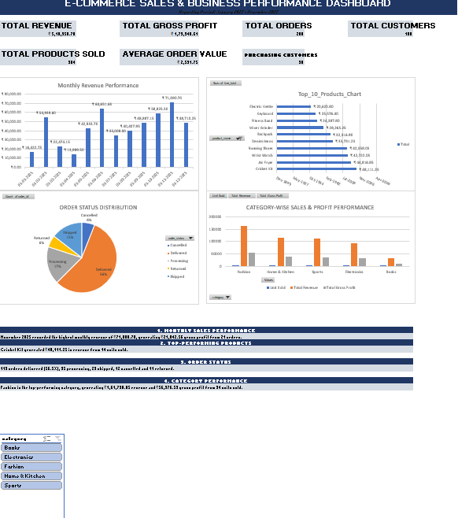

# E-Commerce Sales & Business Performance Analysis

## Project Overview
An end-to-end e-commerce data analytics project using Microsoft Excel to analyze sales, revenue, profitability, customer behavior, product performance, and order status for 2025.

## Tools & Technologies
- Microsoft Excel
- Power Query
- PivotTables
- PivotCharts
- Excel Formulas
- Interactive Slicers

## Dataset
- 100 registered customers
- 30 products
- 200 orders
- 294 order-item records
- 200 payment records

## Key Business Results
- Total Revenue: ₹5,18,350.70
- Total Gross Profit: ₹1,73,948.61
- Total Orders: 200
- Total Customers: 100
- Purchasing Customers: 90
- Units Sold: 384
- Average Order Value: ₹2,591.75

## Key Insights
- November 2025 recorded the highest monthly revenue of ₹71,080.70.
- Fashion was the highest-revenue category at ₹1,61,730.85.
- Cricket Kit was the highest-revenue product at ₹48,111.25.
- Diya Reddy was the highest-revenue customer at ₹34,232.75.
- 113 orders were delivered, representing 56.5% of all orders.

## Dashboard Features
- Sales and profit KPI cards
- Monthly revenue trend
- Top 10 products by revenue
- Category performance analysis
- Order status distribution
- Interactive category slicer

## Project Outcome
This project demonstrates practical Excel data cleaning, transformation, analysis, visualization, and business reporting skills.
## Dashboard Preview

